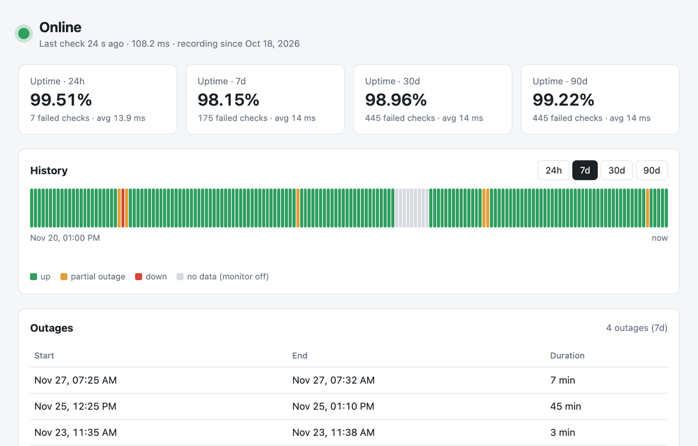

<div align="center">

# netwatch

**A tiny, zero-config internet uptime monitor for your Raspberry Pi (or anything else).**

Checks once a minute whether your home internet is up, and shows the history in a clean web UI.<br>
Think Uptime Kuma, but for a single question: *"was my internet down, and when?"*

[](https://github.com/okuyanf61/netwatch/actions/workflows/ci.yml)
[](https://github.com/okuyanf61/netwatch/pkgs/container/netwatch)

[](LICENSE)

<picture>
  <source media="(prefers-color-scheme: dark)" srcset="docs/screenshot-dark.png">
  
</picture>

</div>

## Features

- **Zero config.** Run it and you're done. No env vars, accounts or setup wizards.
- **Featherweight.** One TCP handshake per minute (~3 packets, no DNS, no HTTP), ~15 MB RAM, near-zero CPU.
- **No dependencies.** A single Python file using only the standard library. SQLite for storage.
- **Works offline.** The UI is fully self-contained (no CDNs), so you can open it from your LAN while the internet is down.
- **Useful history.** Uptime for 24h / 7d / 30d / 90d, a status bar timeline, latency, and a list of every outage with its duration.
- **Honest gaps.** If the monitor itself was off, that time shows as *no data* instead of being counted as an outage.
- **Multi-arch images.** `amd64`, `arm64`, `armv7` and `armv6`, so it runs on everything from a Pi Zero to a NAS or a server.
- Light and dark mode, English and Turkish UI (follows your browser).

## Quick start

```bash
docker run -d --name netwatch --restart unless-stopped \
  -p 8080:8080 -v netwatch-data:/data \
  ghcr.io/okuyanf61/netwatch:latest
```

Open **http://&lt;your-pi&gt;:8080**. The first check runs within a minute.

### Docker Compose

```yaml
services:
  netwatch:
    image: ghcr.io/okuyanf61/netwatch:latest
    container_name: netwatch
    restart: unless-stopped
    ports:
      - "8080:8080"
    volumes:
      - netwatch-data:/data

volumes:
  netwatch-data:
```

```bash
docker compose up -d
```

### Without Docker

Needs Python 3.8+ only.

```bash
python3 netwatch.py            # data goes to ./data/netwatch.db
```

To run it as a service on a Raspberry Pi, see [`contrib/systemd/netwatch.service`](contrib/systemd/netwatch.service):

```bash
sudo mkdir -p /opt/netwatch && sudo cp netwatch.py /opt/netwatch/
sudo cp contrib/systemd/netwatch.service /etc/systemd/system/
sudo systemctl daemon-reload && sudo systemctl enable --now netwatch
```

## How it works

Every minute, netwatch opens a TCP connection to `1.1.1.1:443` and closes it right away. If that fails it tries `8.8.8.8`, then `9.9.9.9`. If any of them answer within 3 seconds, the internet is **up** and the handshake time is stored as latency. Otherwise it is **down**.

Each result is a single row in SQLite (`/data/netwatch.db`). A year of data is a few MB, and rows older than 365 days are pruned automatically.

## Configuration (optional)

Everything has sensible defaults. Override with environment variables if you want:

| Variable | Default | Description |
|---|---|---|
| `NETWATCH_INTERVAL` | `60` | Seconds between checks |
| `NETWATCH_TARGETS` | `1.1.1.1,8.8.8.8,9.9.9.9` | Hosts tried in order, as `host` or `host:port` (default port 443) |
| `NETWATCH_TIMEOUT` | `3` | Connect timeout per target, in seconds |
| `NETWATCH_RETENTION_DAYS` | `365` | How long to keep history |
| `NETWATCH_PORT` | `8080` | Web UI port |
| `NETWATCH_BIND` | `0.0.0.0` | Web UI bind address |
| `NETWATCH_DB` | `/data/netwatch.db` (Docker)<br>`./data/netwatch.db` (bare) | SQLite file path |

## API

| Endpoint | Description |
|---|---|
| `GET /api/data?range=24h\|7d\|30d\|90d` | Current status, uptime stats, timeline buckets and outages as JSON |
| `GET /healthz` | Liveness probe, returns `ok` |

## Image tags

| Tag | Meaning |
|---|---|
| `latest` | Latest build from `main` |
| `1`, `1.2`, `1.2.3` | Released versions (git tags `v1.2.3`) |
| `sha-abc1234` | A specific commit |

## Releases

Releases are fully automatic. Every push to `main` is checked against [Conventional Commits](https://www.conventionalcommits.org/) since the last tag:

| Commit | Release |
|---|---|
| `fix: ...`, `perf: ...` | patch (`1.2.3` → `1.2.4`) |
| `feat: ...` | minor (`1.2.3` → `1.3.0`) |
| `feat!: ...` or a `BREAKING CHANGE:` footer | major (`1.2.3` → `2.0.0`) |
| `docs:`, `ci:`, `build:`, `chore:`, `refactor:`, `test:` | no release (image still rebuilt as `latest`) |

When a release is due, CI tags the commit, publishes a GitHub release with grouped notes, and pushes the `X.Y.Z`, `X.Y`, `X` and `latest` images. See [`scripts/next_release.py`](scripts/next_release.py).

## Notes

- **Raspberry Pi clock.** Pis before the Pi 5 have no real-time clock. If the Pi reboots *while* the internet is down, its clock may be off until NTP syncs, so timestamps recorded in that window can be shifted. A Pi 5 with an RTC battery doesn't have this problem.
- **Security.** The UI has no authentication. It's meant for your LAN, so don't expose it to the internet.

## License

[MIT](LICENSE)
